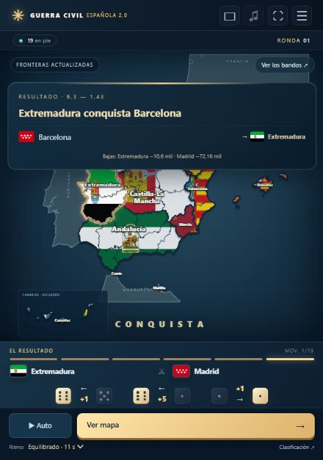

# Guerra Civil Española 2.0

**Un mapa. Diecinueve bandos. Una sola comunidad vencedora.**

Un juego de estrategia y azar donde las comunidades autónomas compiten por unificar España, provincia a provincia. Las fronteras cambian, las capitales caen y las comunidades eliminadas pueden regresar gracias a una liberación inesperada.

El juego se desarrolla sobre las **50 provincias y las ciudades de Ceuta y Melilla**. Cada comunidad empieza con sus provincias reales y su población. Portugal, Francia y Marruecos completan el contexto del mapa como territorios neutrales.



## La partida

Cada ronda concede **un movimiento a cada comunidad**. Los bandos pequeños suelen actuar primero; los grandes, al final. Antes de una guerra se anuncian los rivales y el motivo: anexionar una provincia o liberar una comunidad que haya desaparecido.

La batalla se resuelve con tres dados por bando, comparados de mayor a menor. Cada pareja suma la diferencia de sus dados al vencedor; un empate da un punto a la defensa. La población aporta una ventaja limitada: los grandes tienen más fuerza, pero los pequeños conservan posibilidades de sorprender.

Una victoria cumple primero el objetivo declarado. Si es contundente, puede cambiar varias provincias. Las conquistas y liberaciones pueden combinarse en la misma guerra. Una comunidad liberada puede volver con una sola provincia de su territorio original, sin recuperar necesariamente todas.

Ambos bandos pierden habitantes en cada combate. El atacante derrotado recibe además una penalización del 2 %, y una derrota aplastante puede provocar un contraataque territorial. Las capitales tienen una defensa adicional; si se pierden, se trasladan a otra provincia propia.

El vencedor es el último bando que permanece en el mapa, controlando todo el territorio jugable.

## Fronteras terrestres y marítimas

Los ataques necesitan una frontera válida entre provincias. Por mar, las costas se agrupan en tres zonas: **norte**, **Mediterráneo** y **sur**. Murcia conecta las dos últimas. Canarias enlaza sus provincias con las costas de Galicia, Andalucía, Ceuta y Melilla.

Los bandos aprovechan las costas que controlan realmente: conquistar una provincia costera puede abrir nuevas rutas; perderla puede cerrarlas. Una provincia interior no se convierte en objetivo marítimo por pertenecer a una comunidad que también tenga costa.

## Una guerra para ver cómo cambia el mapa

- Banderas recortadas a los territorios de cada bando, también cuando están separados.
- Cámara dinámica, flechas de ataque, tiradas animadas y efectos de conquista.
- Resultado de cada guerra con las provincias transferidas y las banderas del dueño anterior y del nuevo.
- Una pausa con el mapa despejado después de cada batalla.
- Clasificación al terminar la ronda y pantalla final para la comunidad vencedora.
- Música ambiental y efectos de sonido generados por el juego.
- Partida guardada automáticamente en el navegador.

## Controles y ritmo

| Control | Función |
| --- | --- |
| **Auto / Pausar** | Ver la simulación avanzar o detenerla cuando quieras. |
| **Botón de avance** | Descubrir cada fase manualmente: dados, resultado, mapa y siguiente batalla. |
| **Ritmo** | Cinemático, Equilibrado o Ágil; todos reservan tiempo para leer el resultado y observar el mapa. |
| **Orientación** | Cambiar entre distribución vertical y horizontal. |
| **Sonido** | Activar música y efectos; ajustar sus opciones desde el menú. |
| **Menú** | Consultar reglas, clasificación, historial, orden de ronda o comenzar otra partida. |

El ritmo **Equilibrado** dura unos 11 segundos por batalla. Cinemático ofrece más tiempo para seguirla y Ágil acelera la partida.

## En ordenador y móvil

La interfaz ocupa la pantalla disponible y se adapta a ambas orientaciones. Está preparada para publicarse como una web en **GitHub Pages** y abrirse desde un enlace, sin instalar una aplicación.

El modo actual es una **simulación automática o por pasos**. El modo de controlar una comunidad contra la máquina está previsto en la arquitectura, pero todavía no tiene interfaz. Cada visitante mantiene su propia partida: no es multijugador.

## Ejecutar el proyecto

Con Node.js 20 o superior:

```sh
npm start
```

Abre **http://127.0.0.1:4173/**. Todos los mapas, banderas y componentes necesarios están incluidos; no hace falta instalar dependencias para arrancar.

La [guía técnica](docs/GUIA_TECNICA.md) explica cómo ejecutarlo, modificarlo y publicarlo en GitHub Pages. También puedes consultar las [reglas detalladas](docs/REGLAS.md), la [arquitectura](docs/ARQUITECTURA.md) y las [fuentes de datos y componentes](THIRD_PARTY_NOTICES.md).
